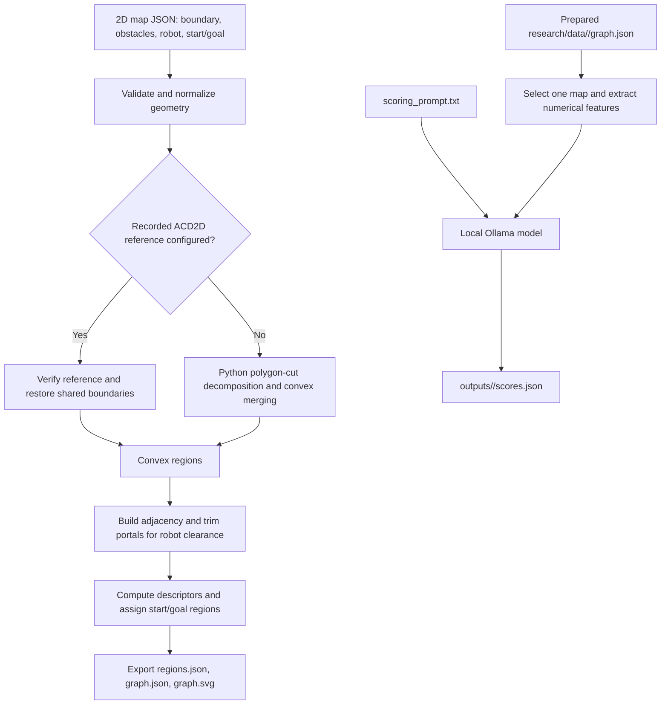
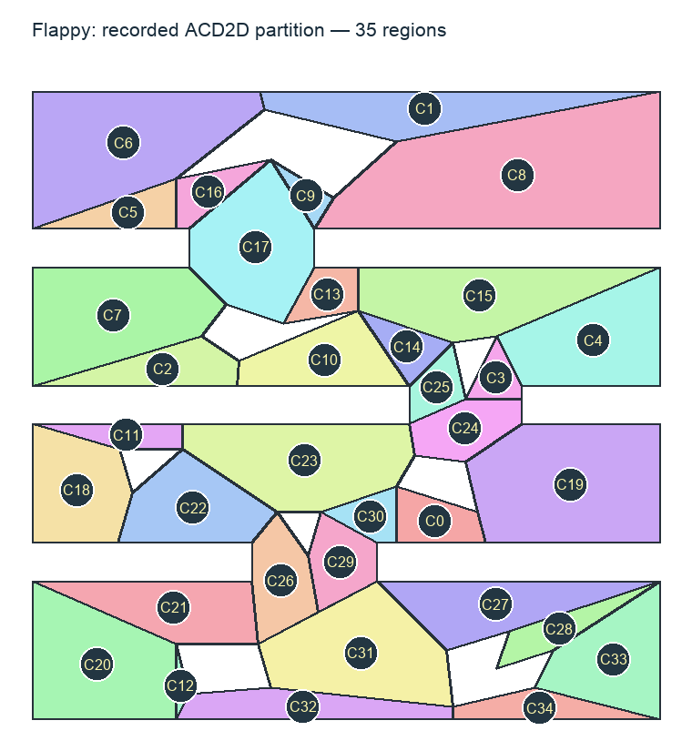

# Convex Region Graph

A Python research project for turning 2D polygon maps into a graph of convex free-space regions and evaluating their local geometric suitability with a small language model through Ollama.

The project combines geometry processing, graph construction, numerical descriptors, and prompt-based scoring. It produces inspectable JSON files and SVG visualizations for studying region connectivity and preparing inputs for motion-planning experiments.

## Overview

Each convex region becomes a graph vertex. Regions sharing a usable boundary segment are connected through a **portal**, represented by two directed edges. Robot radius and safety margin determine the clearance used to trim portals and validate start/goal positions.

The geometry stage computes measurable features such as clearance, shape, connectivity, and portal width. The scoring stage sends those features to a local model, which returns an integer score from **0 to 10** with a short explanation.

The current workflow prepares graphs and scores. It does not generate robot trajectories or train model weights.

## Features

- Four prepared maps: `hole`, `narrow`, `flappy`, and `room`.
- Recorded ACD2D partition import with source checksums and geometry validation.
- Python polygon-cut decomposition for map inputs without a recorded partition.
- Region adjacency, portal geometry, clearance filtering, and connected components.
- Start/goal validation and identification of their containing regions.
- Region and edge descriptors calculated in Python.
- Local Ollama scoring with a configurable English prompt and structured JSON output.
- Per-map selection, JSON exports, SVG previews, and geometry tests.

## Processing flow



**The two commands currently use separate file paths:** graph building writes to `outputs/<map>/`, while scoring reads the prepared `research/data/<map>/graph.json`. Rebuilding a graph does not automatically switch the scorer to the new output.

## Prepared maps

| Map | Convex regions | Directed edges |
|---|---:|---:|
| `hole` | 9 | 22 |
| `narrow` | 18 | 40 |
| `flappy` | 35 | 86 |
| `room` | 83 | 206 |

Each adjacency is stored in both directions. The counts above describe the bundled prepared graphs; changing robot clearance can change the graph connectivity.

### Flappy preview



### About ACD2D

All four prepared maps import recorded ACD2D partitions. Flappy retains the reference region IDs **C0 through C34**.

This is an import of supplied partitions, not a new execution of the original ACD2D C++ program. The original version and parameter settings are unavailable. The importer restores shared boundaries affected by rounded source coordinates, preserves region IDs and counts, and checks convexity, coverage, and overlap. Source and repair information are recorded in decomposition metadata.

A reference is tied to the map boundary and obstacles. Editing that geometry requires a matching reference or selecting the Python backend by removing the top-level `acd2d_reference` configuration. The Python backend follows a concavity-driven cutting strategy and is not the original ACD2D implementation; it need not reproduce the recorded layouts.

Neither decomposition path uses a triangle mesh. Triangle sampling in descriptor calculation only approximates mean clearance inside already-created regions.

Original ACD2D implementation: [jmlien/acd2d](https://github.com/jmlien/acd2d).

## Repository structure

```text
DACN-main/
├── README.md                         # Project overview and shared setup
├── README_LOCAL.md                   # Owner-specific paths and commands
├── convex-region-graph/
│   ├── build_graph.py                # Geometry pipeline, graph export, SVG
│   ├── acd.py                        # Python concavity-driven polygon cuts
│   ├── acd2d_reference.py            # Recorded partition import and repair
│   ├── region_descriptors.py         # Region and edge feature calculation
│   ├── score_maps.py                 # Selected-map scoring through Ollama
│   ├── scoring_prompt.txt            # Scoring definitions and rubric
│   ├── requirements.txt              # NumPy and Shapely dependencies
│   ├── research/data/                # Prepared inputs and reference graphs
│   │   ├── hole/
│   │   ├── narrow/
│   │   ├── flappy/
│   │   └── room/
│   ├── outputs/                      # Generated graphs and scoring results
│   ├── test_build_graph.py
│   └── tests/                        # Decomposition and descriptor tests
└── sampling-based-path-finding-main/  # Separate original ROS/C++ planner
```

The ROS/C++ planner is separate from the Python workflow documented here.

## Getting started

### Requirements

- Python 3.14 for the documented environment.
- NumPy and Shapely, installed from `requirements.txt`.
- Ollama and a downloaded model for the scoring step only.

The commands below use macOS/Linux shell syntax. Open your copy of the project in VS Code and select **Terminal > New Terminal**. Replace the placeholder with your checkout location.

```bash
cd "/path/to/DACN-main/convex-region-graph"
python3.14 -m venv .venv
source .venv/bin/activate
python -m pip install -r requirements.txt
```

Run all commands below from `convex-region-graph/`. In later terminal sessions, enter that directory and run `source .venv/bin/activate`.

For this project's owner, [README_LOCAL.md](README_LOCAL.md) contains the full local paths.

### 1. Select and view a map

```bash
MAP=flappy
```

Choose `hole`, `narrow`, `flappy`, or `room`. Open `research/data/<map>/graph.svg` in a browser. On macOS:

```bash
open "research/data/$MAP/graph.svg"
```

Prepared SVG previews can be viewed without installing Python packages or Ollama.

### 2. Build a graph

Prepared graphs are included, so this step is optional when scoring the bundled data.

```bash
python build_graph.py "research/data/$MAP/map.json" \
  --output "outputs/$MAP/graph.json" \
  --regions-output "outputs/$MAP/regions.json" \
  --svg "outputs/$MAP/graph.svg"
```

On macOS, view the generated visualization with:

```bash
open "outputs/$MAP/graph.svg"
```

### 3. Configure Ollama

Install [Ollama](https://ollama.com/), start it, and download the model you want to use. Check the exact installed name:

```bash
ollama list
```

Set `MODEL` in `score_maps.py` to that name. The current setting is:

```python
MODEL = "qwen3:4b-instruct"
```

The scorer sends requests to `http://localhost:11434/api/chat`. It uses Python's standard library, so no additional Python Ollama client is required.

### 4. Score one map

Review `scoring_prompt.txt` to adjust the scoring rubric, then run:

```bash
python score_maps.py --map "$MAP"
```

For example, to score only Room:

```bash
python score_maps.py --map room
```

Run these commands in a normal terminal, not inside Ollama's `>>>` chat prompt. Chat instructions pasted into an interactive Ollama session are not used by this script; it reads `scoring_prompt.txt` for each run.

The script evaluates regions and unique undirected connections sequentially. It reuses each edge score for the reverse direction. Results are saved after the selected map finishes, replacing any previous `outputs/<map>/scores.json`.

## Inputs and outputs

### Map input

`research/data/<map>/map.json` contains a `map` object with:

- `boundary`: workspace polygon.
- `obstacles`: obstacle polygons.
- `start` and `goal`: optional endpoint coordinates, supplied together.
- `robot_radius` and `safety_margin`: clearance settings.

The optional top-level `acd2d_reference` object selects a recorded partition. The graph builder also accepts precomputed `regions` input, but without the original map geometry it cannot calculate obstacle-clearance descriptors or recover start/goal information automatically.

### Result files

| File | Purpose |
|---|---|
| `research/data/<map>/graph.json` | Prepared graph currently read by the scorer |
| `research/data/<map>/acd2d_reference.json` | Recorded region polygons and source metadata |
| `research/data/<map>/import_audit.json` | Bundled geometry audit; not regenerated by the build command |
| `outputs/<map>/regions.json` | Regions exported by graph building |
| `outputs/<map>/graph.json` | Generated vertices, directed edges, components, planning data, and descriptors |
| `outputs/<map>/graph.svg` | Generated map, region, and graph visualization |
| `outputs/<map>/scores.json` | Selected map name, model name, region scores, and edge scores |

### Geometric features

| Feature | Location in `graph.json` | Meaning |
|---|---|---|
| `area`, `diameter`, `aspect_ratio`, `compactness` | `vertices[].descriptors` | Region size and shape |
| `mean_clearance`, `centroid_clearance` | `vertices[].descriptors` | Distance to obstacles and workspace boundary |
| `degree`, `safe_degree`, `conductance`, `safe_conductance` | `vertices[].descriptors` | Geometric and clearance-filtered connectivity |
| `portal_width`, `safe_portal_width` | `directed_edges[]` | Original and trimmed portal lengths |
| `traversability`, `safe_traversability` | `directed_edges[]` | Portal width multiplied by the smaller mean clearance of its two regions |
| `required_clearance`, `start`, `goal`, endpoint region IDs | `planning` | Robot clearance and problem configuration |

Aspect ratio uses the covariance eigenvalue ratio `lambda_max / lambda_min`. Compactness uses `perimeter² / (4 × pi × area)`. Clearance is measured against physical obstacles and the workspace boundary, not artificial region boundaries. Bundled map lengths use a simulation-meter convention; their source datasets do not establish a physical calibration.

### Score format

Each scored region or edge contains a status, an integer score from 0 to 10, and an explanation. For example, an illustrative region result is:

```json
{
  "id": "C0",
  "status": "scored",
  "score": 7,
  "reason": "Good clearance and usable connections, with moderate elongation."
}
```

Other statuses are `insufficient_data` and `infeasible`, with a null score. Higher scores indicate more favorable local geometry. They do not measure progress toward the goal or the probability of successful traversal.

## Testing

From `convex-region-graph/`:

```bash
python -m unittest discover -v
```

Tests cover geometry relationships, portal filtering, decomposition coverage, recorded partition integrity, and descriptor calculations. The geometry tests do not require a running Ollama server and do not evaluate model scoring quality.

## Troubleshooting

| Problem | What to check |
|---|---|
| `cd: no such file or directory` | Replace the example path with your checkout location; avoid entering `convex-region-graph` twice. |
| Python dependency import errors | Activate `convex-region-graph/.venv` and install `requirements.txt` with the same interpreter. |
| Ollama connection refused | Start the Ollama app, or run `ollama serve` in a separate terminal if using the CLI without the app. |
| Model not found | Compare `ollama list` with the `MODEL` setting in `score_maps.py`. |
| `insufficient_data` score | Check the input graph's descriptors and the requirements in `scoring_prompt.txt`. |
| Rebuilt graph changes are absent from scores | The scorer reads `research/data/<map>/graph.json`, not `outputs/<map>/graph.json`. |
| Reference checksum or geometry mismatch | Restore the matching reference/map pair, or intentionally use the Python decomposition backend. |

## Current scope and limitations

- Scoring is prompt-based inference; no fine-tuning pipeline is included.
- Region/edge scores are experimental judgments, not calibrated probabilities or collision-free guarantees.
- Portal endpoint trimming is a geometric heuristic, not a complete robot configuration-space collision check.
- The current workflow does not implement S-guide/T-guide, score-driven path planning, or ROS integration.
- The scoring CLI supports the four bundled maps and currently reads only their prepared graphs.
- Scores are written when a map finishes; interrupted runs do not save partial results or resume automatically.
- Recorded partitions reproduce supplied layouts through import and bounded coordinate repair. They do not establish reproducibility of the unavailable original ACD2D execution parameters.
