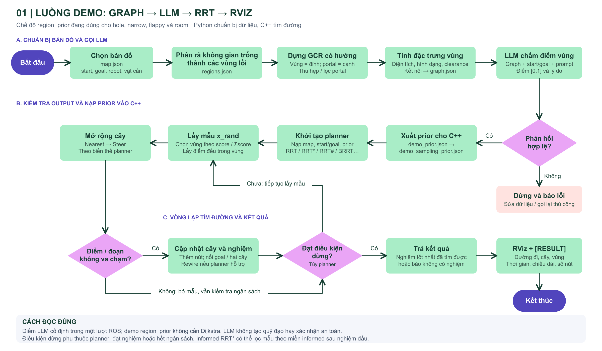
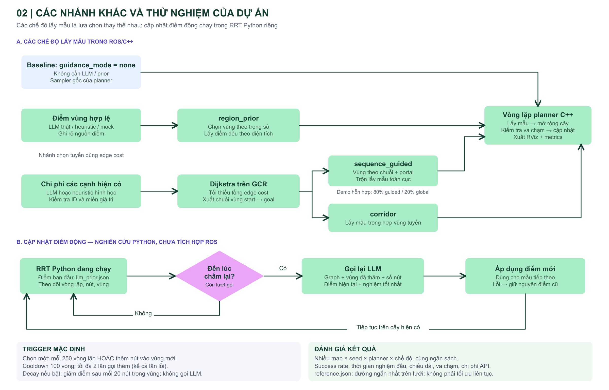

# Flowchart trình bày dự án

## Hình 1: Demo hiện tại

- Bản vector để phóng to hoặc chèn vào slide: [01-demo-flow.svg](01-demo-flow.svg).
- Luồng chính: bản đồ → vùng lồi → GCR và đặc trưng → điểm LLM → kiểm tra và xuất prior → planner C++ → RViz.
- Với các map nghiên cứu đã nhập sẵn, bước phân rã và xây graph đã được thực hiện; lệnh vẽ trong README demo chỉ dựng SVG từ dữ liệu đó.
- Chế độ `region_prior` lấy mẫu trực tiếp theo điểm vùng; không bắt buộc tìm tuyến Dijkstra trước.
- Điểm LLM cố định trong một lượt ROS. Chỉ quá trình mở rộng cây, kiểm tra va chạm và điều kiện dừng diễn ra trong vòng lặp.
- Sơ đồ mô tả vòng lặp chung; chi tiết nối hai cây, rewiring và điều kiện kết thúc phụ thuộc planner. Informed RRT* còn giới hạn miền lấy mẫu sau khi có nghiệm.

## Hình 2: Các nhánh khác trong dự án

- Bản vector: [02-project-branches.svg](02-project-branches.svg).
- `none`, `region_prior`, `sequence_guided`, `corridor` là các chế độ thay thế nhau.
- Dijkstra tối thiểu hóa tổng cost trên graph, không trực tiếp tạo đường chuyển động tối ưu liên tục.
- Chiến lược sequence có thể trộn lấy mẫu vùng, portal và toàn cục; 80/20 là cấu hình demo, không phải hằng số tối ưu.
- Pipeline hợp nhất có thể chuyển điểm thành softmax và trộn khám phá trước khi xuất prior; luồng demo trực tiếp dùng `export_sampling_prior.py` giữ nguyên điểm đã kiểm tra.
- Cập nhật động thuộc RRT Python nghiên cứu. Gọi LLM đồng bộ khi đủ điều kiện; mặc định tối đa 2 lần gọi thêm, gồm cả lần lỗi. Chưa tích hợp vào ROS/RViz.
- Phân biệt benchmark C++/ROS và nghiên cứu RRT Python khi trình bày kết quả.

## Đối chiếu mã nguồn

| Nội dung | Mã nguồn |
|---|---|
| Phân rã, graph, portal và vẽ | `convex-region-graph/build_graph.py` |
| Đặc trưng vùng | `convex-region-graph/region_descriptors.py` |
| Gọi LLM và kiểm tra điểm | `convex-region-graph/llm_region_prior.py` |
| Xuất dữ liệu cho C++ | `convex-region-graph/export_sampling_prior.py` |
| Chi phí cạnh, tuyến Dijkstra và prior hợp nhất | `convex-region-graph/llm_region_planner.py` |
| Xuất chiến lược sequence/corridor | `convex-region-graph/export_sampling_corridor.py` |
| Nạp mode và xuất metrics | `sampling-based-path-finding-main/src/path_finder/src/test_planner.cpp` |
| Các chế độ lấy mẫu | `sampling-based-path-finding-main/src/path_finder/include/path_finder/sampler.h` |
| Trigger và decay | `convex-region-graph/research/adaptive.py` |
| Vòng lặp nghiên cứu và gọi lại LLM | `convex-region-graph/research/rrt_experiment.py` |

Tạo lại SVG bằng `python3 docs/project-flow/render_flowcharts.py` từ thư mục gốc dự án. Các PNG là bản render của SVG cùng tên.
